# Architecture

One question goes through these steps. The code is in `src/pipeline.py` (`run_question`).

```mermaid
flowchart TD
    Q["User question"] --> PB["Prompt builder<br/>prompts/vN.txt + real schema"]
    PB --> LLM["LLM: gpt-oss-120b on Groq<br/>every reply cached in logs/cache"]
    LLM --> PARSE{"Parse reply"}
    PARSE -->|"CANNOT_ANSWER"| REF["Refusal shown to user"]
    PARSE -->|"SQL"| VAL{"Validator<br/>one SELECT, known tables"}
    PARSE -->|"no SQL found"| BAD["Format failure"]
    VAL -->|"unsafe: write, stacked, comment, system table"| BLK["Blocked, with reason"]
    VAL -->|"ok"| DB[("Read-only SQLite<br/>mode=ro + query_only + authorizer<br/>200 rows, 10 s limit")]
    VAL -->|"broken, e.g. unknown table"| RP
    BAD -->|"v4 only"| RP
    DB -->|"rows"| EXP["Result table + one-line explanation"]
    DB -->|"SQL error or 0 rows, v4 only"| RP["Repair prompt: original prompt +<br/>bad SQL + exact error<br/>max 2 retries"]
    RP --> LLM
```



## Steps

| step | file | what it does |
|---|---|---|
| Prompt builder | `src/build_prompt.py` | Loads `prompts/vN.txt` and fills `{schema}` and `{question}` in one pass. The schema text is read from the database (`src/schema.py`), never typed by hand. v1 gets table and column names; v2 to v4 get the real `CREATE TABLE` text. |
| LLM | `src/llm.py` | `ask(prompt, tag)` sends one user message to Groq with the settings in `src/config.py`. Replies are cached by a hash of (model, settings, prompt, repeat number), so reruns and the offline demo cost nothing. Every call, cached or not, is logged to `logs/calls.csv`. Rate limits are retried with backoff. |
| Parse reply | `src/pipeline.py` `parse()` | Pulls the SQL out of the reply (```sql block, or the first SELECT/WITH line) and the one-line explanation. A reply starting with CANNOT_ANSWER is a refusal. |
| Validator | `src/validate.py` | Allows exactly one statement that starts with SELECT or WITH. Rejects write/admin keywords, stacked statements, comments, unclosed quotes, system tables, other schemas and unknown tables. Text inside string literals is ignored, so `LIKE '%drop%'` is fine. Returns `(ok, reason)`. |
| Read-only SQLite | `src/run_sql.py` | Opens `data/olist.db` with `mode=ro`, turns on `PRAGMA query_only`, and sets an authorizer that only allows reading. So even SQL that slipped past the validator cannot write, attach files or read `sqlite_master`. Returns at most 200 rows and stops queries after 10 seconds. |
| Repair loop (v4 only) | `src/pipeline.py`, `prompts/repair.txt` | If the SQL is broken, errors or returns 0 rows, the model gets the original prompt, its SQL and the exact error message, up to 2 times. Unsafe SQL is never sent for repair: it stays blocked. |
| Explanation or refusal | `src/pipeline.py` | The final result has the status (`ok`, `empty`, `refused`, `blocked`, `invalid`, `error`, `llm_error`), the SQL, the rows, the model's one-line explanation and the number of repairs. |

## Three safety layers

An attack has to get past all three:

1. **Prompt:** the instructions say SELECT only, and to reply CANNOT_ANSWER when the question can't be answered.
2. **Validator:** rejects the SQL text before it touches the database.
3. **Read-only connection:** the database itself refuses writes.

`eval/run_redteam.py` tests each layer. It runs the attack text through the full pipeline, and also sends the attacker's SQL straight to the validator and straight to the read-only connection.

## Evaluation path

`eval/run_eval.py` runs a prompt version over a split of `eval/test_set.json`. `eval/score.py` re-runs each generated query and compares its result with the gold result (row order and column names ignored, floats rounded to 2 places). The results CSV is written to `logs/results_<version>_<split>_<time>.csv`.
