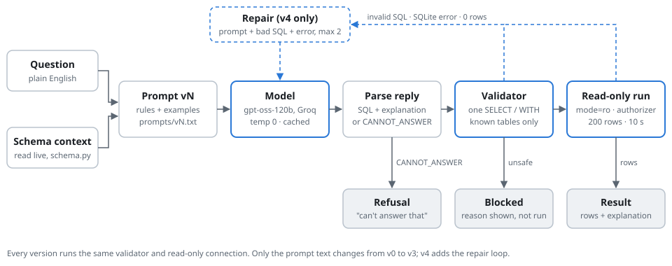

# Design: how a question becomes an answer



The same diagram as Mermaid is in [architecture.md](architecture.md).

## Task decomposition

The job "answer a business question from the Olist database" is split into small steps. Only one of them (step 3) uses the model. Everything after the model is ordinary code that does not trust the model's output.

| # | step | code | input | output |
|---|---|---|---|---|
| 1 | Read the schema | `src/schema.py` | `data/olist.db` | v1: a `table(col, col, ...)` list. v2–v4: the real `CREATE TABLE` text. Read from the database each time, never typed by hand |
| 2 | Build the prompt | `src/build_prompt.py`, `prompts/vN.txt` | question + schema text | one prompt string. v2–v4 add join keys and business rules; v3–v4 add 5 worked examples |
| 3 | Ask the model | `src/llm.py` | prompt string | reply text. Settings in `src/config.py`: gpt-oss-120b, temperature 0, top_p 1, 2048 tokens, reasoning effort medium. Every reply is cached in `logs/cache/` and every call is logged in `logs/calls.csv` |
| 4 | Parse the reply | `src/pipeline.py` `parse()` | reply text | `(sql, explanation, refused)`. Takes the first ```sql block, or the lines starting at SELECT/WITH. `CANNOT_ANSWER` sets refused |
| 5 | Validate | `src/validate.py` | SQL text | `(ok, reason)`. Allows exactly one statement starting with SELECT or WITH. Rejects comments, stacked statements, write/admin keywords, `sqlite_*` and `pragma_*` objects, other schemas, and tables that do not exist. `is_unsafe(reason)` separates attacks (status `blocked`) from broken SQL (status `invalid`) |
| 6 | Run read-only | `src/run_sql.py` | validated SQL | rows, or an error. The connection is opened with `mode=ro`, `PRAGMA query_only=ON` and an authorizer that only allows reads and denies `sqlite_*` tables. Results stop at 200 rows and queries stop after 10 seconds |
| 7 | Repair (v4 only) | `src/pipeline.py`, `prompts/repair.txt` | original prompt + bad SQL + exact error | a new reply, which goes back to step 4. Runs at most 2 times, only for `invalid`, `error` or 0 rows. Never for `blocked` or a refusal |
| 8 | Show the answer | `app/app.py` | status, SQL, rows, explanation | the table, the SQL, a one-line explanation and a badge per step |

## Status values

| status | meaning |
|---|---|
| `ok` | ran and returned rows |
| `empty` | ran, 0 rows |
| `refused` | model replied `CANNOT_ANSWER` |
| `blocked` | validator found an unsafe query; it is never run |
| `invalid` | no SQL, or the validator rejected it for a non-safety reason (e.g. unknown table) |
| `error` | SQLite error while running |
| `llm_error` | the API call failed, or offline and not in the cache; left out of all scores |

## Why the safety does not depend on the prompt

The prompt asks the model to write SELECT only, but nothing relies on that. Steps 5 and 6 are independent: the validator works on the text, and the read-only connection refuses writes even when the validator is skipped. `eval/run_redteam.py` tests each layer alone (`validator alone`, `read-only DB alone`) and both together with the model.

## Evaluation (offline from the cache)

`eval/run_eval.py` runs step 1–7 for every question of a split and scores the result with `eval/score.py`: the generated query and the gold query are both run and their rows compared (order and column names ignored, floats rounded to 2 places). `eval/stats.py` adds 95% confidence intervals with the question as the unit, and `eval/significance.py` compares versions with a paired exact McNemar test (Holm-corrected).
